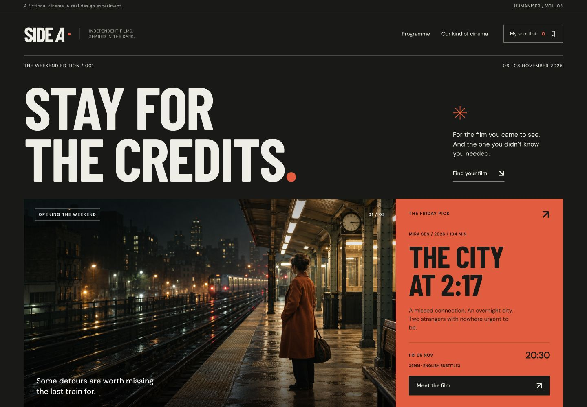
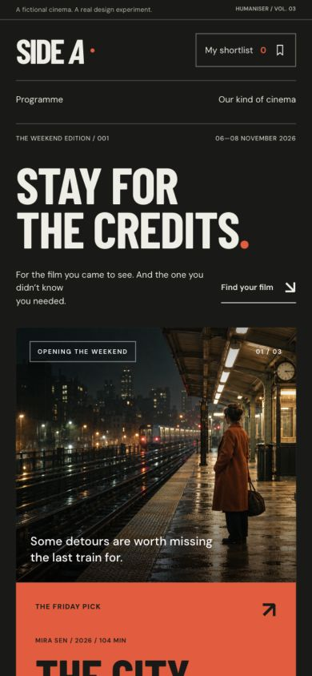

# Side A — a Humaniser v3 showcase

**[Open the interactive website](https://kenny042312-blip.github.io/ai-website-humaniser/)**



A fictional independent cinema made using [AI Website Humaniser 3.0.0](https://github.com/kenny042312-blip/ai-website-humaniser/releases/tag/v3.0.0). It demonstrates a different subject and visual direction from the earlier Low Water harbour example.

## Try it

- Filter the six screenings by day and projection format. Sunday plus 35mm demonstrates the no-results state and reset.
- Open film notes from an image, title or screening time.
- Save screenings to a shortlist, remove individual choices, or clear and undo.
- Reload to see that saved choices persist in this browser.
- Download a real text-file plan. Saving does not reserve a ticket.

The cinema, films, filmmakers and screenings are invented. The three film images are original generated illustrations for this project, not stills from real releases. The site labels this explicitly. It has no account system, ticket checkout, form submission or application analytics.

## The design decisions

**Visitor/task:** a curious filmgoer chooses a weekend screening and keeps a personal shortlist.

**Primary material:** a dated film programme, with runtime, format, language and editorial context beside the relevant actions. It is structured around choosing a film, rather than a generic product-marketing sequence.

**Visual direction:** a cinema programme meets a film poster: charcoal, warm white and orange, condensed display lettering, substantial film images and tightly aligned screening information. The featured film, programme and editorial note use different compositions because they serve different jobs.

**Behavior:** local saving and honest feedback; combined filters with recovery; semantic dialogs with focus return; responsive reading order and reduced-motion support. There is no invented purchase confirmation or artificial loading delay.

This is a practical example, not evidence that visitors prefer v3, not an authorship detector and not a guarantee of a particular visual result. The [validation record](validation.md) explains what is actually checked.



## Run locally

From the repository root:

```sh
python3 -m http.server 8000 --directory docs
```

Open `http://localhost:8000/`. No package installation or build is required. The browser loads the ES modules over HTTP. Images, fonts and scripts use relative paths so the same files work under the repository's GitHub Pages path.

The shortlist uses `side-a-shortlist-v1` in browser local storage. If storage is unavailable, the interface says saving lasts only for the current page and offers the text download.

## Files and hosting

| File | Purpose |
|---|---|
| `index.html` | Page structure and metadata |
| `style.css` | Responsive visual system and states |
| `data.js` | Three fictional films, six screenings and data helpers |
| `app.js` | Filters, film dialogs, shortlist and download |
| `assets/` | Original artwork, favicon and licensed fonts |
| `artwork-prompts.json` | Built-in image-generation method, complete prompts and relative asset paths |
| `screenshots/` | Desktop, mobile and editorial previews |
| `validation.md` | Observed checks and evidence limits |

GitHub Pages publishes this buildless directory from `main` → `/docs`, following [GitHub's publishing-source workflow](https://docs.github.com/en/pages/getting-started-with-github-pages/configuring-a-publishing-source-for-your-github-pages-site). `.nojekyll` keeps these static assets as authored. The fictional demonstration retains `noindex`; that is not an access control.

The existing private Sites deployment and its access policy are unchanged. Hosting credentials, account state, Sites metadata and local machine paths are not part of this showcase.

## References and assets

On 31 October 2026, text/initial HTML from [Metrograph's programme](https://metrograph.com/film/) supplies an example of grouping director, runtime, format and time; [Prince Charles Cinema's programme](https://princecharlescinema.com/whats-on/) supplies an example of format filters and subtitle modifiers. Those are content-structure observations, not rendered visual or interaction audits. Their branding, copy, images and films are not copied here.

Fonts: [Barlow Condensed](https://github.com/google/fonts/tree/main/ofl/barlowcondensed) and [DM Sans](https://github.com/google/fonts/tree/main/ofl/dmsans), self-hosted with their SIL Open Font License notices in `assets/fonts/`. The [artwork prompt record](artwork-prompts.json) documents three separate built-in image-generation calls. Images are copied unchanged into the site.
